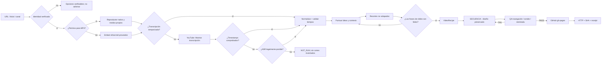

# FLUJO · De un video a una presentación
Contrato maestro: [FLOW_INDEX.json](./FLOW_INDEX.json) y [flow.json](./versions/1.0.0/flow.json).

No son pasos decorativos: cada caja se corresponde con IDs del JSON. Al bloquearse cualquier prueba se conserva la evidencia y se marca `FAIL/NOT_RUN`.
